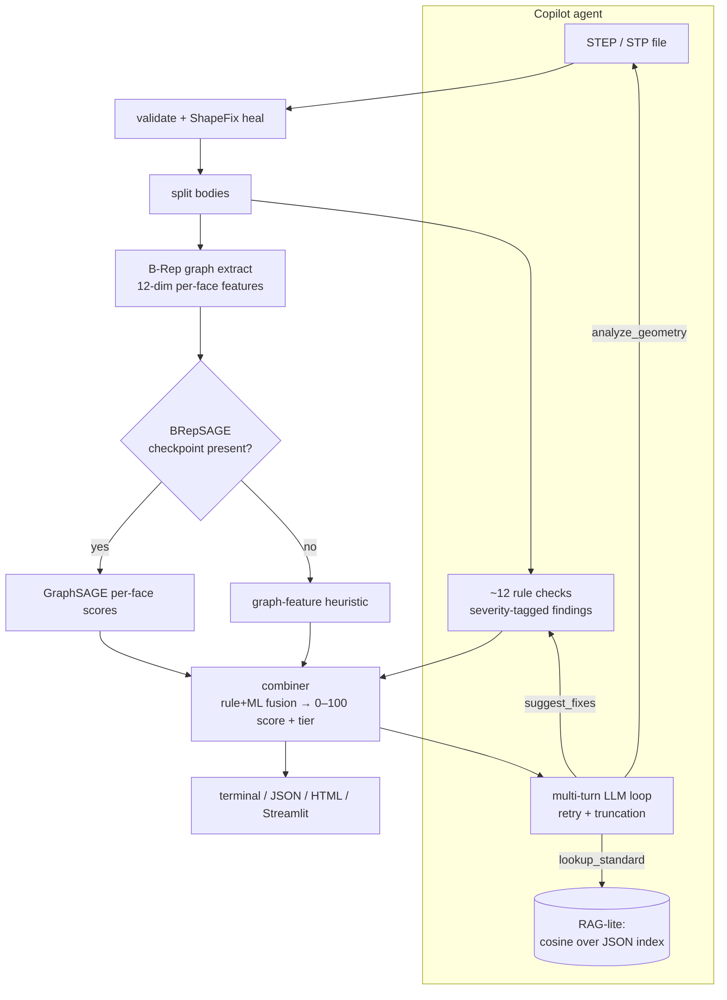
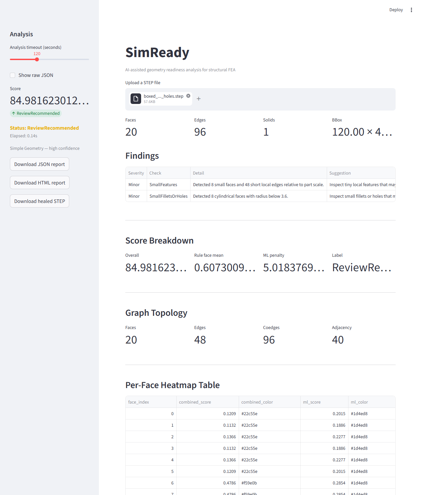

# SimReady

An AI copilot for FEA pre-processing, and a geometry checker used to score AI-generated
CAD. Point it at a STEP file; it analyzes B-Rep geometry for meshing/manufacturability
problems, scores simulation-readiness 0–100, and explains the findings through a
multi-turn LLM agent.

**Scope: analysis and validation, plus constrained generation.** SimReady reads geometry
and reports on it (healing is a best-effort OCC ShapeFix pass, not a design edit).
Generation is live: the agent's `build_part` tool materializes a typed box/cyl/fuse/cut
spec into a STEP file (no LLM code is executed — see
`docs/adr/0001-geometry-gen-dsl-over-codegen.md`), and the end-to-end generate→analyze
loop passes the strengthened mechanical/final-analysis gate on 5/5 prompts in a fresh GLM 5.3
run (`docs/validation/geometry_gen_eval.md`).

## Direction: from checking CAD to scoring CAD generation

The project started as an analysis tool. It is now moving toward **generating CAD and
measuring whether the generation is any good**, with SimReady's checker as one of the
measures. Two tracks, in this order:

1. **Image → CadQuery (GenCAD-Code), first model done.** Qwen2.5-VL-3B fine-tuned with
   QLoRA on `CADCODER/GenCAD-Code`, scored with MecAgent's own metric code on the dataset's
   100-row test subset: valid-syntax rate **0/100 untuned → 88/100 tuned**, IoU_best 0.256.
   Every generated part is also run through the SimReady checker, which catches defects
   IoU cannot see (a part with IoU 0.83 that self-intersects). Results below;
   full record in `docs/validation/gencad_eval.md`.
2. **Text → CAD with a checker-scored benchmark (SP1 → SP2 → SP3), planned and started.**
   The current generation gate (5 prompts, every model 5/5) no longer separates models.
   SP1 replaces it with a 50-concept × 3-phrasing benchmark whose constraints are checked in
   code (hole clearances, bore sizes, patterns, wall thickness), SP2 widens the generation
   vocabulary, and SP3 post-trains a small model with the checker as the reward. See
   [Roadmap](#roadmap).

The common thread: a generated part that compiles and looks right can still be unusable
for simulation or manufacturing. SimReady's rule checks are the part of the stack that says
so, which makes them useful as an evaluation metric and, later, as a training reward.

## Capabilities

- **Multi-turn LLM tool-use agent** over the pythonOCC pipeline. Provider-swappable via
  one `OPENAI_BASE_URL` env var (OpenAI / NVIDIA NIM / OpenRouter / local Ollama+shim).
  Exponential-backoff retry on rate-limit/transient errors; token-budgeted tool-result
  truncation (drops per-face score blobs → ML internals → caps findings, in that order)
  so large CAD reports don't blow the context window. Four tools: `analyze_geometry`,
  `suggest_fixes`, `lookup_standard` (RAG), `build_part` (typed-DSL geometry generation).
  — `simready/copilot/agent.py`, `tools.py`
- **B-Rep → graph encoder feeding a GNN.** OCC topology is walked into a face-adjacency
  graph with **12-dim per-face features** (surface-type one-hot ×7, log-area, normal
  magnitude, mean curvature, UV-u extent, UV-v extent). A **2-layer GraphSAGE** ("BRepSAGE")
  with three heads: per-face refinement (binary), per-face complexity (regression), and a
  graph-level 4-class defect classifier. The refinement label is rule-derived
  (`rule_per_face > 0.5`) and therefore circular; the defect head trains on **injected
  ground-truth defect tags** — a genuinely non-circular signal. **Dual backend with honest
  provenance** — trained checkpoint when present, graph-feature heuristic when not; every
  report states `weights_loaded` / `score_source` / `model_name`.
  — `simready/ml/model.py`, `brepnet.py`, `graph_extractor.py`
- **Eval discipline.** A 6-metric copilot harness (tool-call exact/partial/order, format,
  sections, theme hit-rate) scored against a **50-example hand-written gold set** held out
  of all training data. The GNN ships with a real-CAD validation gate that *documents where
  it fails* instead of hiding it (see Results), and CI runs both a fast spec job and the
  full OCC suite in a micromamba env. — `scripts/eval_finetune.py`,
  `tests/data/gold_traces.jsonl`, `docs/validation/`, `.github/workflows/`
- **Vision-language fine-tune for CAD code (GenCAD track).** QLoRA on Qwen2.5-VL-3B
  (Unsloth, free Colab T4, resumable from Drive) for image → CadQuery, an eval notebook that
  calls MecAgent's metric code unchanged, and a **checker bridge**: CadQuery program → STEP →
  `analyze_file_safe` → checker verdict next to VSR and IoU, for both the generated and the
  reference part. — `notebooks/gencad_*.ipynb`, `scripts/gencad_*.py`
- Rule layer: ~12 OCC geometry checks (manifoldness, zero-length/short edges, sliver faces,
  thin solids, self-intersection, small features/fillets) fused with the GNN into one 0–100
  score + complexity tier. Self-intersection check hardened against OCC pathologies
  (face-count guard + 30 s watchdog: a part that hung >10 min now finishes in 6.3 s).
- Reports in four forms: terminal, JSON, single-file HTML, and two Streamlit UIs
  (analysis dashboard + agent chat).

## Architecture



## Quickstart

### 1. Create the environment

Prerequisite: install [Miniforge](https://conda-forge.org/download/) (includes `conda`) or
[micromamba](https://mamba.readthedocs.io/en/latest/installation/micromamba-installation.html),
then restart the shell so the command is available. pythonOCC is installed from conda-forge;
the project does not support a pip-only OCC install.

Windows PowerShell, from the repository root:

```powershell
micromamba create -f environment.yml -y    # or: conda env create -f environment.yml
micromamba activate simready               # conda: conda activate simready
python -m pip install -r requirements.txt
python -c "import OCC, torch_geometric, pydantic, streamlit; print('setup OK')"
```

`requirements.txt` includes PyTorch Geometric and Pydantic directly. On Windows, install
PyG after the conda PyTorch package as shown; if pip selects an incompatible wheel, use the
[PyG installation guide](https://pytorch-geometric.readthedocs.io/en/latest/install/installation.html)
for the shown torch/Python versions rather than mixing a second torch installation.

Linux/macOS: use the same create/install commands and your environment manager's normal
`activate` command. CI exercises `environment.yml` + `requirements.txt` on Ubuntu.

### 2. Analyze a part — no LLM or API key

```powershell
python -m simready.cli analyze tests/data/smoke_box.step
python -m simready.cli analyze part.step --json
python -m simready.cli analyze part.step --html report.html
python -m simready.cli analyze part.step --export-healed out.step
```

A missing dependency, invalid input, timeout, or failed analysis prints its validation error
and exits nonzero. It never reports unanalyzed geometry as clean.

### 3. Generate then analyze a part — no LLM or API key

This deterministic demo exercises the same trusted `build_part` executor used by the agent.
It writes a new STEP under `data/gen_parts/`, prints its path, then analyzes that exact artifact:

```powershell
$built = python -m simready.gen.build | Select-Object -Last 1 | ConvertFrom-Json
python -m simready.cli analyze $built.step_path
```

Expected build evidence: `occ_valid: true`, 7 faces, bounding box 80 × 60 × 10 mm. The
centered through-hole has diameter 10 mm. `data/gen_parts/` is Git-ignored, so repeated runs
do not add generated artifacts to Git.

For scripted mechanical checks, `simready.gen.verify.verify_part_spec` checks declared box
dimensions and centered through-holes; `analyze_generated_part` rejects failed analysis rather
than treating a tool call as proof of success.

### 4. Run the copilot — needs an OpenAI-compatible endpoint

```powershell
Copy-Item .env.example .env
# Edit .env: set OPENAI_API_KEY and OPENAI_MODEL. Leave OPENAI_BASE_URL blank for
# OpenAI, or replace BOTH base URL and model for another provider.
python -m simready.copilot.cli tests/data/smoke_box.step "What's wrong with this part and how do I fix it?"
python -m streamlit run ui/copilot_app.py
python -m streamlit run ui/app.py
```

In the chat sidebar, **Demo CAD** includes the committed `tests/data/smoke_box.step` fixture
on a fresh checkout. Select it and click **Analyze selected STEP**. To exercise generation in
chat, ask: `Create an 80 x 60 x 10 mm plate with a centered 10 mm through-hole.` The agent
should call `build_part`, then `analyze_geometry` on the returned `data/gen_parts/*.step` path.
Provider availability, tool-call support and response prose still depend on the selected model.
The analysis-only dashboard accepts STEP upload without an LLM key.

Analysis dashboard (`ui/app.py`) on a ribbed-bracket fixture — findings, fused score
breakdown, graph topology, and the per-face heatmap table (combined + ML scores). Regenerate
with `python scripts/ui_screenshots.py` against a running UI.



Provider config (`.env`): `OPENAI_API_KEY` (required), `OPENAI_BASE_URL`
(blank = OpenAI · Vultr `https://api.vultrinference.com/v1` · NIM `https://integrate.api.nvidia.com/v1` · OpenRouter
`https://openrouter.ai/api/v1` · Ollama `http://localhost:11434/v1`), `OPENAI_MODEL`.

Optional full FEA-standards index for `lookup_standard`. A small committed seed index works
on fresh clones; build the full local index for broader coverage:

```bash
# add public PDF URLs to data/fea_docs/sources.txt, then:
python scripts/scrape_fea_docs.py
python scripts/index_fea_docs.py   # → data/fea_docs_index.json
```

## Results & Limitations

Exact reproduction commands and evidence boundaries: `docs/validation/reproduce-results.md`.

**Read the label-source column before the accuracy column.** The model's *refinement* head
trains on `rule_per_face > 0.5` — a deterministic threshold on the *same* OCC features the GNN
ingests (`scripts/auto_label.py`), so its accuracy measures "can a GraphSAGE re-learn my rule,"
not agreement with external ground truth. The *defect* head is different: it trains on
ground-truth defect tags injected by `scripts/generate_degraded_steps.py`, independent of the
rule layer — a **non-circular** signal.

The tables below describe the **combined-v2 experiment associated with the committed records**:
**2,272 graphs**, source-grouped **1,801 train / 471 validation**, **30 epochs**, CPU-only
(56.18 s in the recorded run). Sources: `weights/brepnet.pt`,
`weights/brepnet_meta.json`, `weights/metrics.json`, and `weights/eval_fixtures.json`.
The older 1,100-graph / 15-epoch v1 result is retained separately below, not presented as the
current checkpoint's validation result.

### Held-out validation — combined-v2 (n=471 val graphs · source-grouped 80/20)

Every degraded variant of a base part stays on one side of the split. This v2 validation set
adds randomized fillet/chamfer features and is not directly comparable to the easier v1 split.

| Head | Label | Metric | Value |
|---|---|---|--:|
| Refinement (per-face) | `rule_per_face>0.5` — **circular** | accuracy / precision / recall | 0.825 / 0.929 / 0.609 |
| Defect (graph-level, 4-class) | injected tags — **non-circular** | accuracy | 0.686 |

Defect per-class accuracy: clean 0.679 · open_shell 0.856 · sliver_face 1.00 ·
**self_intersection 0.212** — a weak result, not a production-ready defect classifier.

### Held-out fixtures — combined-v2 checkpoint

| Eval set | n | Distribution | Acc | Prec | Recall |
|---|---|---|---|--:|--:|--:|
| Hand-built fixtures | 27 graphs / 3,612 faces | harder, hand-made (out-of-train) | 0.853 | 0.920 | 0.895 |
| Real GrabCAD (unlabeled) | 3 parts, 87 / 107 / 161 faces | real CAD imports | ML aggregate **0.37–0.45** vs rule mean 0.67–0.88 |||

**Fresh inference verification, 2026-10-24:** running
`python scripts/evaluate.py data/labels_fixtures_v2 weights/brepnet.pt` with the project
environment and `PYTHONPATH` set reproduced 27 graphs / 3,612 faces and
accuracy .853 / precision .920 / recall .895 / F1 .908. This ties the committed checkpoint to
the fixture metrics. It is not a fresh training run or independent validation of the labels.

Historical v1 comparison: the earlier 1,100-graph checkpoint recorded validation refinement
.848 / .944 / .487, defect accuracy .756, and 7-fixture / 51-face refinement .725 / .750 / .692.
Those numbers belong to the v1 experiment and its easier validation/fixture setup; do not mix
them with the combined-v2 rows above. Fixture defect accuracy is not a usable metric because
the deliberately broken fixtures lack complete defect tags.

On real GrabCAD the model still scores below the rule layer (overall 37.5 / 36.6 / 61.0;
latency 7.45 / 2.22 / 2.87 s wall-clock for the full pipeline). That gap is documented, not hidden.

On a larger real-CAD probe (12 McMaster-Carr STEPs — brackets, flanges, bearings, housings)
the pipeline now analyzes **11/12** parts with zero hangs (freeform-face precheck +
subprocess-isolated `analyze_file_safe`; one part skipped at 854 faces), but the **defect head
false-positives on all 11** — synthetic box/cyl training can't cover real surface types
(B-splines, cones, tori). A feature-randomization retrain (2272 graphs) did not move that
number; recorded as an honest negative rather than retried
(`docs/validation/real_eval_v2.md`, `defect_classifier.md`, `occ_hang_diagnosis.md`).

### Image → CadQuery — GenCAD-Code (MecAgent technical test)

Task and metric are MecAgent's public technical test: generate CadQuery code from a render
on `CADCODER/GenCAD-Code`, scored by `metrics/best_iou.py` called unchanged. Eval set: the
dataset's `hundred_subset` of the test split (100 of 7,355 rows), its own prompt, greedy
decoding. VSR = program runs and yields a solid.

| Model | VSR | IoU_best (valid only) | IoU_best (invalid = 0) |
|---|--:|--:|--:|
| Qwen2.5-VL-3B-Instruct, untuned (4-bit) | 0/100 | — | 0.000 |
| Qwen2.5-VL-3B + QLoRA (6k examples, 1 epoch, T4) | **88/100** | 0.256 | 0.225 |

How to read it:

- **0 → 88 is mostly format.** The untuned model answers in invented JSON; the tuned one
  writes runnable GenCAD-style CadQuery. A stronger one-shot-prompt baseline is planned so
  the comparison is not against a model that never writes Python.
- **All 12 failures are runaway generations** (output hits the token limit mid-line, usually
  after more sketches than the reference). No CadQuery API errors.
- **Geometry is the weak part, and it falls with complexity.** IoU is bimodal (median 0.047,
  22 of 88 at ≥ 0.5). Single-sketch parts: VSR 1.00, mean IoU 0.31; 4–8 sketches: VSR 0.69,
  mean IoU 0.10.
- **The metric compares surface shells, not volumes.** `best_iou.py` voxelizes without
  `.fill()`, so two near-identical solids can score near zero (a tube: 0.010 shell vs 0.588
  filled). Re-scored with only `.fill()` added: mean 0.563. The headline stays MecAgent's
  metric; the filled number is reported beside it.
- **The checker sees what IoU cannot.** Defects present on the generated part but not on its
  reference: 3 self-intersections, 6 thin walls, 1 invalid solid. One self-intersecting part
  scores IoU 0.83. The checker does not measure fidelity (generated parts score slightly
  higher because they are simpler), so it is a third column, not a replacement for IoU.
- **Scale:** 4 % of the training split, 1 epoch. Not comparable to published GenCAD numbers
  without saying so. Adapter (~130 MB) lives on Google Drive, not in git; per-row outputs,
  scores, generated STEPs and checker results are committed under `docs/validation/gencad/`.

### Geometry generation — historical live E_grammar artifact gate (5 prompts)

| Model (provider, date) | Grammar-valid parts | Notes |
|---|--:|---|
| `glm-5.3` (Vultr, 2026-10-05) | 5/5 | one run, no retries |
| `deepseek-v4.1-flash` (Vultr, 2026-10-05) | 5/5 | one run, no retries |
| `z-ai/glm-5.2` (NIM, 2026-07-19) | 5/5 | first attempt |
| `meta/llama-3.3-70b-instruct` (NIM, 2026-07-19) | 3/5 → **5/5** | dropped-final-boolean failure fixed by an orphan-step spec rule + single-tool-call turns; model since retired on NIM |

Every model now passes all five prompts, so this gate no longer separates models; a
checker-scored benchmark with range checks on holes, bores and patterns is in progress
(SP1, see [Roadmap](#roadmap)).

Every generated spec is validated (Pydantic DSL), built by the trusted executor, then run
through the analysis pipeline. The 5/5 rows above are **historical artifact-gate results**:
STEP existence, OCC validity and face-count range. They did not mechanically assert dimensions,
hole placement, successful final analysis, or truthful verdict prose.

The strengthened harness adds declared box dimensions and centered through-hole checks,
successful analysis of the exact final artifact, and an assertion that the agent analyzed that
path. **Fresh run 2026-10-24: Vultr GLM 5.3 passed 5/5** under this stronger gate, one run per
prompt. Compact evidence: `docs/validation/generation_gate_2026-10-24.json`. Verdict prose
remains outside the mechanical gate; it still sometimes overstates mesh readiness.

### Copilot eval — gold set (n=50)

Reference run only: `meta/llama-3.3-70b-instruct` as teacher/ceiling (2026-05-24; the model has since been retired on NIM). A QLoRA adapter
(Qwen2.5-3B, 951 traces, 3 epochs) is trained but **not yet evaluated** on this gold set, so
the base and LoRA columns are still empty (`docs/finetune_results.md`).

| tool_call_exact | partial | order_ok | format_ok | sections_ok | theme_hit |
|--:|--:|--:|--:|--:|--:|
| 0.76 | 0.92 | 0.78 | 0.78 | 0.78 | 0.68 |

### Known limits

- The **refinement head label is still circular** (`rule_per_face>0.5`); only the defect head
  has a non-circular label. No external/non-circular *refinement* target yet; no labeled
  real-CAD test set.
- The **defect head does not generalize to real CAD** — 11/11 false positives on analyzed
  McMaster parts; the gap is the surface-type vocabulary, not data volume (see honest
  negative above).
- Copilot fine-tune: one chat-SFT QLoRA run (Qwen2.5-3B) is trained (loss in
  `docs/finetune_results.md`), but there is **no Base-vs-LoRA result yet** — no claim about
  that model until the gold-set eval runs. (Separate from the GenCAD model, which is evaluated.)
- GenCAD: one model, one training run, 100 eval rows, against a baseline that answers in
  JSON. The checker-bridge numbers assume every part is 100 mm on its longest side, because
  GenCAD parts are unit-normalized and the checker's thresholds are in mm.
- The Python suite mocks LLM-facing clients (5 live-LLM tests are opt-in); test count is not
  an ML-quality signal. Run `python -m pytest -q` for the current environment-specific count.
- Self-intersection check skipped above 150 faces and on freeform (B-spline) faces — OCC
  `BOPAlgo` can hang indefinitely there, and Python-side watchdogs cannot interrupt it
  (`docs/validation/occ_hang_diagnosis.md`); UI/CLI entry points run analysis in a
  killable subprocess instead. Assemblies untested.
- Geometry generation is single-shot (4-op DSL, no refine loop) and slow per eval call
  (40–420 s incl. full analysis). No mesher hook — scores are heuristic screening, not
  correlated against mesher outcomes.

## Roadmap

The order is deliberate: generation work comes first, and every step has to end in a number
that can be checked.

**Done**

- Analysis pipeline, rule checks, BRepSAGE (3 heads), copilot agent with four tools, CI.
- Typed-DSL generation (`build_part`, ADR 0001) and the historical 5-prompt artifact gate:
  5/5 on GLM 5.3, DeepSeek V4.1 Flash, GLM 5.2 and Llama 3.3 70B.
- GenCAD image → CadQuery, first model: Qwen2.5-VL-3B QLoRA, VSR 0 → 88/100, plus the
  checker bridge and the shell-vs-filled IoU finding.

**Now — GenCAD follow-ups** (`docs/validation/gencad_eval.md`, "Next steps")

1. **Stopping problem:** all 12 failures are runaway generations. Try a stop rule or
   repetition penalty at inference, no retraining, and re-score the same 100 rows.
2. **Stronger baseline:** the same untuned model with one example program in the prompt.
3. **Second model:** Gemma-3-4B with the same two notebooks, against its own untuned base.

**Next — text → CAD, in three sub-projects**

1. **SP1: checker-scored text-to-CAD benchmark.** 50 part concepts, each phrased three ways:
   *explicit* (every dimension given), *engineer-style* ("NEMA 17 mount, 5 mm plate") and
   *intent-only*. Constraints come from standards and engineering logic (ISO 273 clearance
   holes, NEMA patterns, bearing bores, minimum walls) and are checked in code as ranges;
   anything genuinely free is marked `not_checked`, never silently passed. Headline metric:
   the **mechanical-reasoning gap**, pass rate (explicit) − pass rate (engineer-style) on the
   same parts. First runs: GLM 5.3 and DeepSeek V4.1 Flash. Status: design reviewed,
   13-task plan written, tasks 1–2 (concept schema + loader, 50-concept draft) on branch
   `sp1-bench`, paused behind the GenCAD work.
   (`docs/exec-plans/active/2026-09-25-sp1-cad-benchmark-design.md`,
   `docs/exec-plans/active/2026-10-04-sp1-bench-implementation.md`)
2. **SP2: generation vocabulary v2.** Extend the 4-op DSL where SP1 shows concepts it cannot
   express. Then compare the DSL against free-form build123d code on the same benchmark, so
   "DSL vs code" becomes a measurement, not an opinion. A repair pass (feed checker errors
   back, up to 2 retries, starting from SP1's logged failures) is reported separately from
   single-shot.
3. **SP3: post-training with the checker as reward.** GRPO on a small open model; the metric
   is fixed now: single-shot pass@1 on held-out prompts, before vs after training. Open
   decision: post-train the text-only Qwen2.5-3B or the GenCAD vision model, and whether
   the reward combines IoU with the checker.

**Later — analysis side**

- A non-circular target for the per-face *refinement* head (meshing-failure outcomes or
  hand-labelled faces), and a labelled real-CAD test set (SimJEB / GrabCAD).
- Defect head on real CAD: hand-labelled real positives and clean real negatives in
  training; synthetic augmentation is exhausted.
- Evaluate the copilot chat-SFT adapter on the gold set once, then stop.
- Mesher (Gmsh) hook — correlate the 0–100 score with actual meshability.

## Project layout

```
simready/        cli · pipeline · validator · healer · checks · occ_utils · report · html_report
  ml/            graph_extractor · model (BRepSAGE) · brepnet (dual-backend) · combiner · dataset
  copilot/       agent (tool-use loop) · tools · rag · cli · renderer (CLI) · png_render
ui/              app.py (analysis) · copilot_app.py (agent chat)
scripts/         train · evaluate · auto_label · generate_parametric_steps · generate_degraded_steps
                 · prep_finetune_dataset · eval_finetune · scrape_fea_docs · index_fea_docs · …
                 · gencad_{reference,analyse,iou_filled,export_reference_steps,checker_bridge}
notebooks/       gencad_baseline · gencad_train_qwen · finetune_copilot (+ _executed)   (Colab)
tests/           unit/integration/UI tests (5 live-LLM opt-in)
weights/         brepnet.pt (16 KB) · metrics.json · brepnet_meta.json · eval_fixtures.json  (tracked)
docs/            validation/ · impl/ · exec-plans/ · sample_output/ (committed CLI output) · img/
                 CONTEXT.md = domain glossary
```

## License

[MIT](LICENSE)
