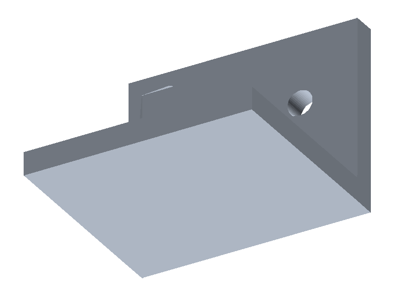
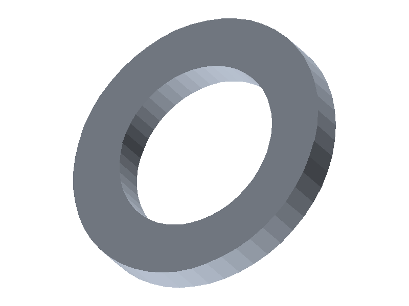
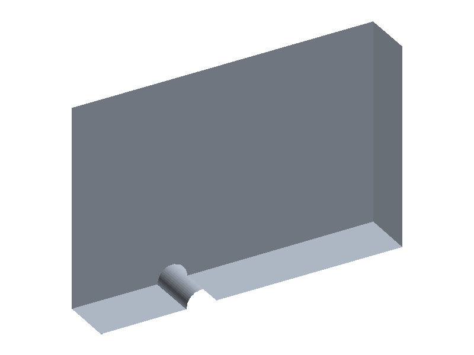

# SP1 Text-to-CAD Benchmark v1 (`bench_v1`)

**Date:** 2026-11-18

Single-shot text-to-CAD evaluation over 50 mechanical part concepts phrased three ways (*explicit*, *engineer-style*, and *intent-only*; 150 prompts total: 37 in-vocab concepts / 111 prompts expressible in the 4-operation `box`/`cyl`/`fuse`/`cut` DSL, and 13 out-of-vocab concepts / 39 prompts reported separately). Two reference ceiling models (`gpt-6.1-sol` and `gemini-4-argon` on D Labs) were evaluated at `k = 5` attempts per prompt (`temperature = 0.7`, 750 calls per model) and graded in a subprocess by the deterministic OCCT range checker (`CHECKER_VERSION = 1.0.0`, `system_prompt_sha256 = 3dd19661924d...`, frozen `concepts_v1.sha256 = 3a662823fca1...`).

## 1. Setup

| model | id | base URL | k | temp | prompt sha256 | checker | official | started | incomplete prompts |
|---|---|---|---|---|---|---|---|---|---|
| gpt-6.1-sol | `gpt-6.1-sol` | https://api.dlabkeys.com/v1 | 5 | 0.7 | `3a662823fca1` | 1.0.0 | True | 2026-11-18T15:48:17+00:00 | 0 |
| gemini-4-argon | `gemini-4-argon` | https://api.dlabkeys.com/v1 | 5 | 0.7 | `3a662823fca1` | 1.0.0 | True | 2026-11-18T15:48:17+00:00 | 0 |

Numbers here are **not comparable** to `docs/validation/geometry_gen_eval.md` (different models, prompts and metric).

## 2. Headline (in-vocab prompts, 95% CI bootstrapped over concepts)

| model | pass@1 | 95% CI | pass@k | 95% CI | concepts | prompts |
|---|---|---|---|---|---|---|
| gpt-6.1-sol | 96.2% | [93.0%, 98.9%] | 98.2% | [95.5%, 100.0%] | 37 | 111 |
| gemini-4-argon | 95.5% | [92.1%, 98.4%] | 97.3% | [94.6%, 100.0%] | 37 | 111 |

## 3. By phrasing (pass@1) and mechanical-reasoning gap

| model | explicit | engineer | intent | gap (explicit - engineer) | paired 95% CI |
|---|---|---|---|---|---|
| gpt-6.1-sol | 97.3% | 94.1% | 97.3% | 3.2% | [-5.4%, 11.9%] |
| gemini-4-argon | 97.3% | 92.4% | 96.8% | 4.9% | [-4.3%, 14.6%] |

## 4. Failure classes (in-vocab, failed attempts)

| model | phrasing | F1_no_parse | F2_schema | F3_reference | F4_build_error | F5_invalid_solid | F6_dimension_miss | F7_feature_miss | F8_timeout | F9_out_of_vocab |
|---|---|---|---|---|---|---|---|---|---|---|
| gpt-6.1-sol | explicit | 0 | 0 | 0 | 0 | 0 | 5 | 0 | 0 | 0 |
| gpt-6.1-sol | engineer | 0 | 0 | 0 | 0 | 0 | 11 | 0 | 0 | 0 |
| gpt-6.1-sol | intent | 0 | 0 | 0 | 0 | 0 | 3 | 2 | 0 | 0 |
| gemini-4-argon | explicit | 0 | 0 | 0 | 0 | 0 | 0 | 5 | 0 | 0 |
| gemini-4-argon | engineer | 2 | 0 | 0 | 0 | 0 | 11 | 1 | 0 | 0 |
| gemini-4-argon | intent | 0 | 0 | 0 | 0 | 0 | 2 | 4 | 0 | 0 |

## 5. Out-of-vocab concepts (reported separately, never in the headline)

| model | outcome | attempts |
|---|---|---|
| gpt-6.1-sol | declined / no spec (F1) | 179 |
| gpt-6.1-sol | faked: built and passed checks | 11 |
| gpt-6.1-sol | faked: built or tried, failed | 5 |
| gemini-4-argon | declined / no spec (F1) | 184 |
| gemini-4-argon | faked: built and passed checks | 10 |
| gemini-4-argon | faked: built or tried, failed | 1 |

## 6. Cost

| model | calls | prompt tokens | completion tokens | median latency (s) | excluded (infra/checker) |
|---|---|---|---|---|---|
| gpt-6.1-sol | 750 | 335860 | 137271 | 6.86 | 0 |
| gemini-4-argon | 750 | 502002 | 979304 | 17.07 | 0 |

## 7. Annotated failures

Three failed in-vocab attempts from the two most frequent failure classes in Section 4 (`F6_dimension_miss` and `F7_feature_miss`), rebuilt from their logged `spec` and rendered with `simready/copilot/png_render.py`.

### 7.1 `gpt-6.1-sol` — `c027/explicit/0` (`F6_dimension_miss`, 5/5 failed on `c027/explicit`)

- **Attempt ID:** `c027/explicit/0` (`gpt-6.1-sol`)
- **Prompt:** An L-bracket 50 mm wide: a base leg 50 x 40 x 5 mm and an upright leg 5 mm thick rising 40 mm along one 50 mm edge. Two 5.5 mm through holes in the base leg only, 25 mm apart, centred across the width and 25 mm from the upright's outer face.
- **Parsed spec:** `{"steps": [{"op": "box", "dx": 50, "dy": 40, "dz": 5, "at": [0, 0, 0]}, {"op": "box", "dx": 50, "dy": 5, "dz": 40, "at": [0, 0, 5]}, {"op": "fuse", "a": 0, "b": 1}, {"op": "cyl", "r": 2.75, "h": 5, "at": [12.5, 25, 0]}, {"op": "cut", "a": 2, "b": 3}, {"op": "cyl", "r": 2.75, "h": 5, "at": [37.5, 25, 0]}, {"op": "cut", "a": 4, "b": 5}]}`
- **Checker report (`failure_class = F6_dimension_miss`):** `[{"type": "bbox_sorted", "status": "fail", "detail": "extents [40.0, 45.0, 50.0] vs [(39.9, 40.1), (39.9, 40.1), (49.9, 50.1)]"}, {"type": "hole_set", "status": "pass", "detail": "pairwise distances [25.0] vs [(24.9, 25.1)]"}]`
- **Diagnosis:** The model stacked the `dz = 40` upright leg on top of the `dz = 5` base leg (`at: [0, 0, 5]`), yielding an overall height of 45.0 mm whereas the checker's `bbox_sorted` range expects a 40.0 mm overall height measured from the bottom face. Note that `c027/explicit`'s wording (*"rising 40 mm along one 50 mm edge"*) does not state the vertical datum explicitly, so interpreting 40 mm above the 5 mm base top is a plausible reading (all 5 GPT-6.1 Sol explicit attempts built 45 mm, while Gemini-4-Argon built 40 mm; scheduled for explicit datum wording in `bench-v1.1`).

### 7.2 `gpt-6.1-sol` — `c031/engineer/0` (`F6_dimension_miss`, 5/5 failed on both models)

- **Attempt ID:** `c031/engineer/0` (`gpt-6.1-sol`)
- **Prompt:** A DIN 988 shim ring for a 10 mm shaft, 2 mm thick (the thickest standard size).
- **Parsed spec:** `{"steps": [{"op": "cyl", "r": 8, "h": 2, "at": [0, 0, 0]}, {"op": "cyl", "r": 5, "h": 2, "at": [0, 0, 0]}, {"op": "cut", "a": 0, "b": 1}]}`
- **Checker report (`failure_class = F6_dimension_miss`):** `[{"type": "bbox_sorted", "status": "fail", "detail": "extents [2.0, 16.0, 16.0] vs [(1.95, 2.0), (15.77, 15.95), (15.77, 15.95)]"}, {"type": "bore", "status": "fail", "detail": "0 matching bores; hole diameters [10.0]"}, {"type": "boss", "status": "fail", "detail": "0 matching bosses; convex diameters [16.0]"}]`
- **Diagnosis:** Both models emitted exact nominal `10.0 x 16.0 x 2.0` mm (`r = 5`, `r = 8`) instead of DIN 988's standard `D12` bore (`10.04–10.19` mm, oversize so the shim slides onto a 10 mm shaft) and `d12` outside diameter (`15.77–15.95` mm).

### 7.3 `gemini-4-argon` — `c029/explicit/0` (`F7_feature_miss`, 5/5 failed on `c029/explicit`)

- **Attempt ID:** `c029/explicit/0` (`gemini-4-argon`)
- **Prompt:** A 60 x 40 x 10 mm plate with two 6 mm through holes on its long centre line, 40 mm apart and centred.
- **Parsed spec:** `{"steps": [{"at": [30, 20, 5], "op": "box", "dy": 40, "dz": 10, "dx": 60}, {"r": 3, "at": [10, 20, 5], "op": "cyl", "h": 10}, {"op": "cyl", "r": 3, "h": 10, "at": [50, 20, 5]}, {"op": "cut", "a": 0, "b": 1}, {"a": 3, "b": 2, "op": "cut"}]}`
- **Checker report (`failure_class = F7_feature_miss`):** `[{"type": "bbox_sorted", "status": "pass", "detail": "extents [10.0, 40.0, 60.0] vs [(9.9, 10.1), (39.9, 40.1), (59.9, 60.1)]"}, {"type": "hole_set", "status": "fail", "detail": "0 matching holes vs count (2.0, 2.0)"}]`
- **Diagnosis:** In the DSL, `box` `at` is the minimum corner `[xmin, ymin, zmin]` while `cyl` `at` is the base centre. Treating `box` `at: [30, 20, 5]` as a centre shifted the plate to `X in [30, 90], Y in [20, 60]`, so the first hole at `[10, 20, 5]` missed in empty space and the second at `[50, 20, 5]` cut a semicircular notch into the `Y = 20` side edge rather than a full interior hole.

## 8. Known limits (generated counts)

- gpt-6.1-sol: 199 `not_checked` results across scored attempts.
- gemini-4-argon: 196 `not_checked` results across scored attempts.
- **No minimum wall-thickness or blind-bore `depth_max` check in v1** (deferred to v1.1 per spec §1.5); unconstrained features are recorded explicitly as `not_checked`, and blind bores such as `c036` enforce `depth_min` plus non-through status rather than an upper bound on pocket depth.
- **Prompt datum ambiguity on `c027/explicit`:** *"rising 40 mm"* leaves open whether the 40 mm height is measured from the bottom face or above the 5 mm base leg (see Section 7.1); scheduled for explicit datum wording in `bench-v1.1`.
- **Weak intent checks on non-cylindrical features:** slots (`c010`), step heights (`c023`), and rectangular cavities (`c048` intent has only `not_checked`) are not directly measured by v1's cylindrical/bounding-box check primitives, inflating intent pass rates relative to engineer phrasing.
- **Authoring scope:** tolerances and design ranges are author-chosen around cited engineering standards, with one author and one proofreader (`docs/exec-plans/completed/2026-11-12-sp1-task2-review.md`).
- **Provider defaults:** thinking/reasoning parameters were left at the provider default for both `gpt-6.1-sol` and `gemini-4-argon` on D Labs (`seed = attempt_idx` sent; deterministic seed enforcement is not assumed; both models share one D Labs endpoint).
- **Spec deviations affecting reading:** (1) `SYSTEM_PROMPT` permits explicit refusal when a part cannot be built with the 4-op DSL (populating Section 5's `declined / no spec (F1)` row on out-of-vocab concepts), and (2) `infra_error` and `checker_error` are excluded from scoring rather than counted as model failures (`0` excluded in both official runs).

- **Checker revision after the official run:** the official logs were graded at `4420e2b`; the tag `bench-checker-1.0.0` (and `v0.5.1`) points at `1e70789`, which changed the through-hole probe in `simready/bench/geometry.py` (single 0.5 mm probe → multi-step probes, so a thin floor at the bottom of a blind hole is never skipped) without bumping `CHECKER_VERSION`. Both logs were regraded under `1e70789` on 2026-11-20 (OCP backend, `python -m simready.bench regrade`): 571 (GPT-6.1 Sol) and 564 (Gemini-4-Argon) attempts re-checked, **0 attempts differ** in `passed`, `partial`, `failure_class`, fingerprint or any per-check status; in-vocab passes stay 534/555 and 530/555. Every number above therefore holds under the tagged checker, and `CHECKER_VERSION` stays `1.0.0`.

**Honesty note:** This report is published as-is; no model was dropped after seeing results, and SP3's post-training metric remains fixed at single-shot `pass@1` on held-out prompts (design D6).
