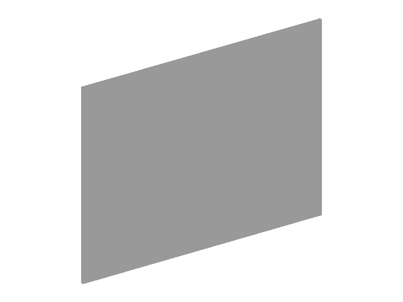
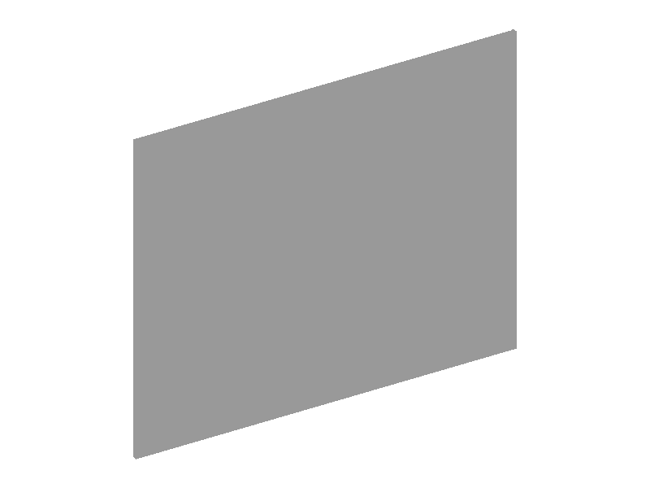
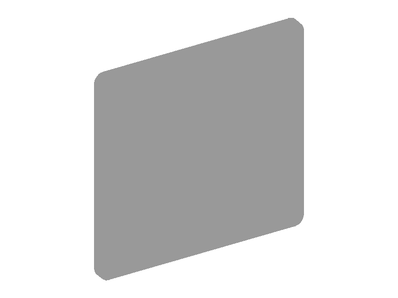
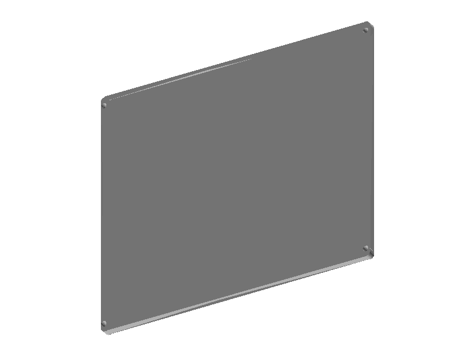
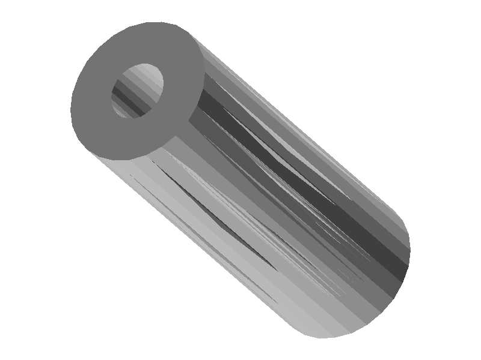
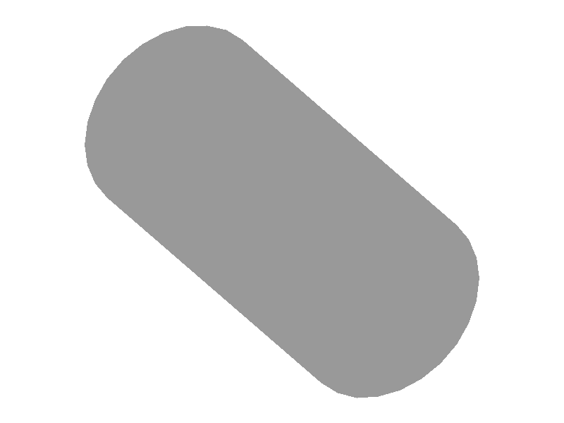

# GenCAD: four walkthrough examples

Qwen2.5-VL-3B + QLoRA, 6k training examples, one epoch. These are selected cases
from the [100-row evaluation](gencad_eval.md), not a representative sample.
Numbers below are saved results; only the geometry dimensions and face counts were
measured for this page.

## 1. idx 400 — single plate

**IoU 1.000; 1 reference sketch, 1 generated sketch.** A single rectangular plate
is the simple runnable case. The generated X and Z dimensions are twice the
reference dimensions; IoU normalizes scale and does not establish dimensional accuracy.

| Reference | Generated |
|---|---|
|  |  |
| bbox XYZ: 0.750000 × 0.615789 × 0.007813; 6 faces | bbox XYZ: 1.500000 × 1.252632 × 0.015625; 6 faces |

Sources: [scores](gencad/scores_qwen25vl3b_qlora.json),
[sketch counts](gencad/per_row_analysis.json).

## 2. idx 350 — generation did not stop

**Invalid; IoU 0; 3 reference sketches, 8 generated sketches; token cap 1825.**
The program ends mid-line with `'(' was never closed` (line 38).
There is no generated STEP or render pair; this is a stopping failure, not a
CadQuery runtime failure.

Last six lines of the saved generated program (including the incomplete final line):

```python
wp_sketch6 = cq.Workplane(cq.Plane(cq.Vector(-0.75, 0.0, -0.28125), cq.Vector(1.0, 6.123233995736766e-17, -6.123233995736766e-17), cq.Vector(6.123233995736766e-17, -1.0, 6.123233995736766e-17)))
loop6=wp_sketch6.moveTo(0.14210526315789473, 0.0).circle(0.14210526315789473)
solid6=wp_sketch6.add(loop6).extrude(0.1484375)
solid=solid.union(solid6)
# Generating a workplane for sketch 7
wp_sketch7 = cq.Workplane(cq.Plane(cq.Vector(-0.75, 0.0, -0.28125), cq.Vector(1.0, 6.123233995736766e-17, -6.123233995736766e-17), cq.Vector(6.123233995736766e-17, -1.0, 6.123233995736766e-1
```

Sources: [sketch counts and error](gencad/per_row_analysis.json),
[saved generation](gencad/gen_qwen25vl3b_qlora.jsonl),
[decoding settings](gencad_eval.md#setup).

## 3. idx 5699 — high IoU, self-intersection flag

**IoU 0.830 shell / 0.893 filled; generated NeedsAttention, overall score 47.5.**
The saved checker flags SelfIntersection (Major) on the generated part, but not
the reference (ReviewRecommended, overall score 77.7).
Overlap and defect checks answer different questions; the render is not proof of the defect.
Measured on the generated STEP: four holes (r 0.016), each centred about 0.018 from the
axis of a rounded corner (r 0.022–0.032), so every hole cuts into a corner round, and no
centre hole. The reference render shows five holes: four set in from the corners and one
in the centre. The plates overlap almost completely, which is what IoU measures.

| Reference | Generated |
|---|---|
|  |  |
| bbox XYZ: 1.500875 × 1.500000 × 0.070313; 15 faces | bbox XYZ: 1.500060 × 1.307921 × 0.039063; 14 faces |

Sources: [IoU variants](gencad/iou_shell_vs_filled.json),
[generated checker](gencad/checker_generated.jsonl),
[reference checker](gencad/checker_reference.jsonl).

## 4. idx 4836 — shell overlap versus filled overlap

**IoU 0.010 shell / 0.588 filled.** Both programs construct a tube, with different
dimensions: reference outer/inner radii 0.138/0.055 and length 0.734; generated
0.182/0.079 and length 0.750. The surface-shell metric counts coincident surface
voxels; filling the grids measures volume overlap instead.

| Reference | Generated |
|---|---|
|  |  |
| bbox XYZ: 0.276316 × 0.276316 × 0.734375; 4 faces | bbox XYZ: 0.363158 × 0.363158 × 0.750000; 4 faces |

Sources: [IoU variants](gencad/iou_shell_vs_filled.json),
[recorded tube dimensions and metric finding](gencad_eval.md#tuned-model-reading-the-numbers).

### Reading limits and reproduction

Bounding boxes are axis-aligned XYZ extents in original GenCAD coordinate units,
not real-world dimensions. The saved checker results used a separate scaling
assumption: largest bbox side = 100 mm. Each image is independently fitted to
800×600 using the same fixed isometric projection, grey shaded by face orientation;
images do not share a physical scale or show checker overlays. Geometry statements
use measurements and saved records, not the renders.
The two self-intersection cases discussed in the evaluation are examples, not a rate.
MecAgent's shell metric remains the headline; the filled variant is supplementary.

From the repo root, after selecting the throwaway mamba root described in the
[handoff](../handoff-2026-11-03-gencad-examples.md):

```bash
micromamba run -n gencad python scripts/gencad_reference.py
micromamba run -n gencad python scripts/gencad_export_reference_steps.py --idx 400 5699 4836
micromamba run -n simready-fix python scripts/gencad_examples.py
```

Reference programs and STEPs stay in ignored `data/gencad/`. Only our geometry
renders are included here; no dataset input images or reference programs are copied.
